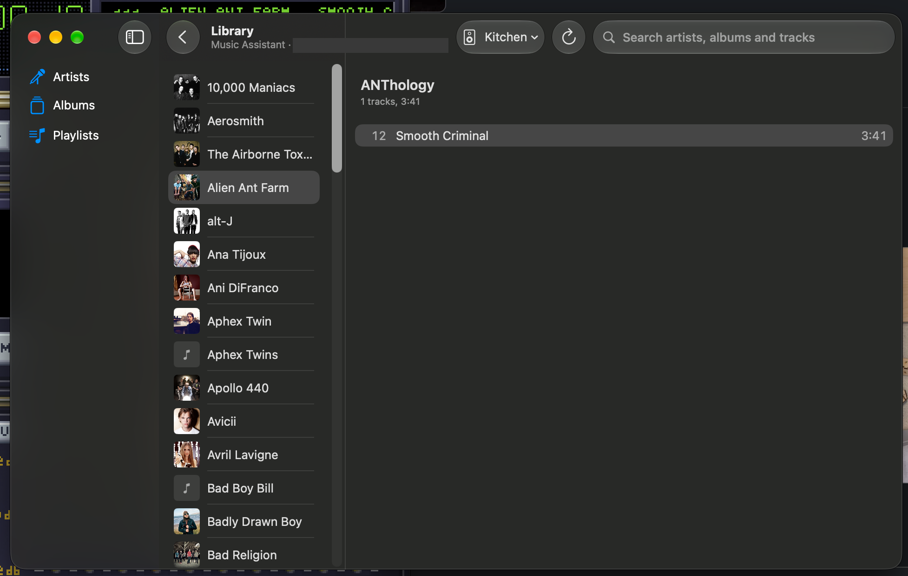

# 0116 — Library sidebar sections can't be selected

| | |
|---|---|
| **Status** | open |
| **Module** | App / LibraryBrowser |
| **Platform** | macOS |
| **First seen** | 2026-10-20 |

## Description

Reported by the user on 0.1.0-2671617 with Music Assistant as the source. In the Library window the sidebar shows Artists, Albums and Playlists, but clicking Albums or Playlists does nothing: the list stays on Artists and no section is highlighted. Only the artist list can be browsed.

(The subtitle's server name is blanked out of the screenshot.)

## Expected behavior

- Clicking a sidebar section selects and highlights it and shows its list (all albums, all playlists).
- The selected section survives closing and reopening the window.

## Relation

- Parent: [#0059](0059.md)
