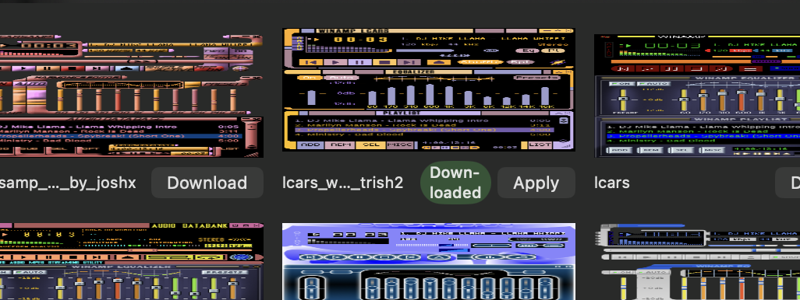

# 0130 — Museum "Downloaded" badge wraps onto two lines and squeezes the skin name

| | |
|---|---|
| **Status** | open |
| **Module** | App / SkinBrowser |
| **Platform** | macOS |
| **First seen** | 2026-10-20 |

## Description

Reported by the user on 0.1.0 (20261021.0604): in the Museum tab of the Skins window (⌘K), a downloaded skin's cell shows the green "Downloaded" capsule broken across two lines ("Down-/loaded"), crowding the name (truncated to "lcars_w…_trish2") and the Apply button in the one-line row under the screenshot.

Cause in `App/SkinBrowser/MuseumCellView.swift`: the badge `Text("Downloaded")` sits in the same `HStack` as the name and the action button, with no `lineLimit(1)` / `fixedSize()`, so SwiftUI compresses it and hyphenates.

## Expected behavior

- The badge never wraps or hyphenates at any cell width.
- The skin name keeps as much room as possible, and the action button (Download / Apply / Retry) never wraps either.
- Suggested: move the badge off the name row onto the screenshot (a small capsule with a checkmark in the top-trailing corner), keep `Apply` as the visible action, and give the button label `.lineLimit(1).fixedSize()`. Keep an accessibility label so VoiceOver still says "Downloaded".

## Relation

- Parent: [#0032](0032.md)
- Related: [#0126](0126.md)
